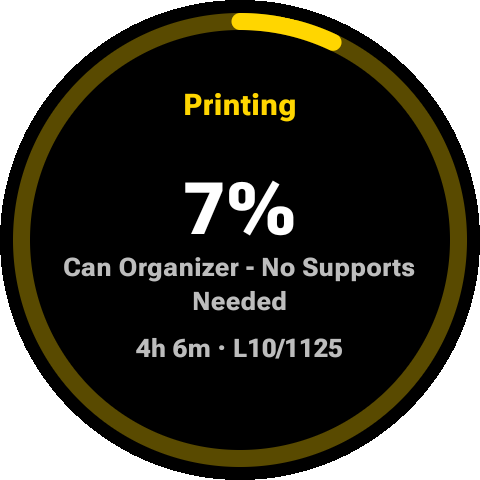
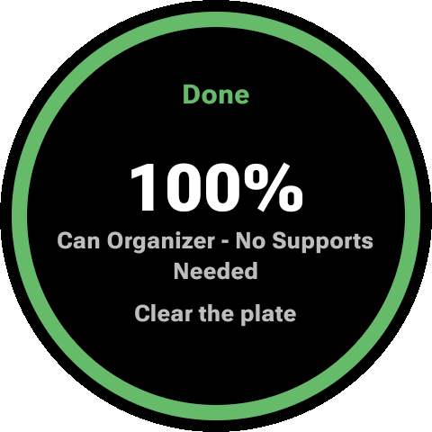
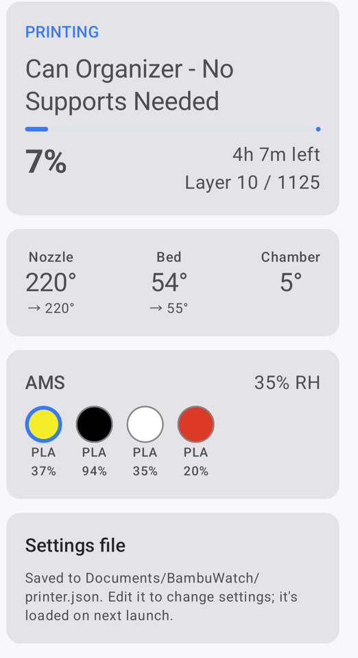
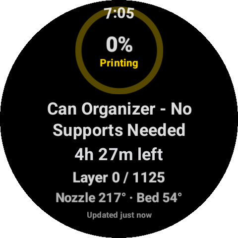
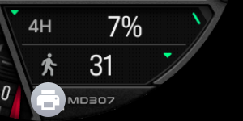

# printWatcher for Bambu Lab

**Your Bambu Lab print, on your wrist.** printWatcher (this repo: BambuWatch) is an Android phone app plus a Wear OS
watch app that shows a Bambu Lab printer's progress on a Galaxy Watch (or any Wear OS watch)
and alerts you when a print finishes or needs attention. Everything stays on your local
network: no Bambu cloud account, no third-party servers.

<table>
  <tr>
    <td align="center"><br><sub>Tile while printing</sub></td>
    <td align="center"><br><sub>Tile when done</sub></td>
    <td align="center"><br><sub>Phone app</sub></td>
  </tr>
  <tr>
    <td align="center"><br><sub>Watch app</sub></td>
    <td align="center" colspan="2"><br><sub>Watch-face complication ("4H 7%") and the print-in-progress icon</sub></td>
  </tr>
</table>

## Features

**On the watch**
- **Tile** with a progress ring that's **green** when idle or done, **yellow** while printing and
  **red** on an error, plus percent, job name, time left and layer. Updates live.
- **Watch-face complication**: progress ring, "67%" with time left, or a one-line summary,
  depending on the slot.
- **Print-in-progress icon** on the watch face (a Wear OS Ongoing Activity) while a print runs.
- **Alerts** mirrored from the phone: print finished, stopped, paused, errors, HMS alerts,
  first layer done, lost connection.

**On the phone**
- Live status: progress, time left, layer, nozzle/bed temperatures, AMS filament colors and amounts.
- Background monitoring with notifications, even when the app is closed.
- Printer settings saved to a plain file on the phone, so they survive reinstalling.

BambuWatch only **reads** printer status. It never sends commands that could affect a print.
Watch controls (pause/resume) may come later as a separate, opt-in feature.

## Requirements

- A Bambu Lab printer on your local network with its **LAN access code** (tested with a **P1S**).
  The printer's IP address, serial number and access code are on its screen under
  **Settings → Network** and **Settings → Device**.
- An Android phone (Android 8.0+) on the same network.
- A Wear OS 3+ watch paired with the phone (tested with a **Galaxy Watch6**, Wear OS 6).

## Getting started

There's no store release yet (a Google Play release is being prepared); build and install with
Android Studio or the command line (see [Build](#build)), then:

1. Open **printWatcher** on the phone and enter the printer's IP address, serial number and access code.
2. Allow notifications, and turn off battery optimization for the app (the battery card on the
   status screen) so alerts aren't delayed.
3. Install the watch app, then add the **printWatcher** tile and complication from the watch.

[Privacy policy](https://projects.darcangel.com/bambuwatch/privacy/)

```
Printer ◄─MQTT/TLS :8883─► Phone app ─Wear OS Data Layer─► Watch app
```

*Not affiliated with or endorsed by Bambu Lab.*

---

# For developers

## Modules

| Module | What |
|---|---|
| `:shared` | Pure Kotlin/JVM. `PrinterState`, `ReportParser` (merges partial MQTT reports), `WatchState` (phone→watch payload), `PrinterCommands`, Data Layer paths. Unit-tested. |
| `:wear` | Wear OS app (same applicationId as the phone app). `DataLayerListenerService` receives `/printer/state`, `WatchStateCache` keeps the latest snapshot, simple Compose status screen. Declares the `bambuwatch_wear` capability so the phone can tell it's installed. |
| `:mobile` | Android app. `PrinterMonitorService` (connectedDevice foreground service, restarts on boot) turns `PrintEventDetector` events into notifications that Wear OS mirrors to the watch. Setup screen (IP / serial / access code, code encrypted via Android Keystore), `PrinterRepository` (HiveMQ MQTT client, reconnect with backoff, `pushall` every 60 s), live status screen. |

## Milestones

- [x] 1. `:shared` state model + merge logic + tests (`./gradlew :shared:test`)
- [x] 2. Phone MQTT client + setup screen, live status
- [x] 3. Foreground service + finish/error notifications
- [x] 4. Data Layer publish + `:wear` module (phone pacing by `WatchSyncPolicy`: important changes immediately, progress every 30 s, heartbeat every 5 min)
- [x] 5. Tile (`PrinterTileService`: progress ring green = idle/done, yellow = printing, red = error; redrawn on every update from the phone, tap opens the watch app)
- [x] 6. Complication + Ongoing Activity
  - `PrinterComplicationService`: RANGED_VALUE (ring + percent, green/yellow/red color ramp on faces that support it), SHORT_TEXT ("67%" / "1h12m"), LONG_TEXT. Add it from the watch face's Customize screen.
  - `PrintOngoingActivity`: printer icon on the watch face while a print runs ("67% · 1h12m"), removed when it ends.
- [ ] 7. Watch → printer commands: deferred; may become a separate app or an opt-in setting (needs LAN-only + Developer Mode on current firmware)

## Build

The phone app has two flavors (the watch app has none):

| Flavor | For | Differences |
|---|---|---|
| `play` | Google Play | No `printer.json` settings file and no direct battery prompt (both need permissions Play restricts). |
| `github` | Sideloading / development | Keeps `Documents/BambuWatch/printer.json` and the direct "Allow unrestricted" battery prompt. |

```
./gradlew :shared:test :wear:testDebugUnitTest            # unit tests
./gradlew :mobile:assembleGithubDebug :wear:assembleDebug  # debug builds
adb install -r mobile/build/outputs/apk/github/debug/mobile-github-debug.apk
```

Release builds (`:mobile:bundlePlayRelease`, `:wear:bundleRelease`, `:mobile:assembleGithubRelease`,
`:wear:assembleRelease`) are signed with the Play upload key when a gitignored `keystore.properties`
exists in the repo root:

```
storeFile=/path/to/printwatcher-upload.jks
storePassword=…
keyAlias=upload
keyPassword=…
```

The phone and watch apps must be signed with the same key (debug with debug, release with release)
for the Data Layer to connect them. Play release steps, listing text and store graphics:
[`docs/play/`](docs/play/README.md).

On Samsung phones, an `adb install` update force-stops the app and monitoring doesn't restart until
the app is opened again.

### Installing on the watch (Galaxy Watch, Wi-Fi debugging)

1. Watch: Settings → About watch → Software information → tap **Software version** 5 times.
2. Settings → Developer options → turn on **ADB debugging** and **Wireless debugging**.
3. Wireless debugging → **Pair new device**: note the IP:port and pairing code, then on the computer:
   ```
   adb pair <ip>:<pair-port> <code>
   adb connect <ip>:<port>          # the port shown on the main Wireless debugging screen
   adb -s <ip>:<port> install -r wear/build/outputs/apk/debug/wear-debug.apk
   ```
Both apps must be signed with the same key (the same machine's debug key is fine) for the Data Layer to connect them.

## Printer settings

Settings (IP, serial, access code) are kept in three places, in this order of priority:

1. **`Documents/BambuWatch/printer.json` on the phone** (`github` flavor only): the main copy once you tap *Allow file access*
   (Android's "All files access", needed to read the file after a reinstall or an `adb push`).
   It survives clearing app data and uninstalling. Saving in the app rewrites it; hand edits are
   loaded on the next launch. If the file is invalid it's ignored, left untouched, and the app shows why.
   ```json
   { "ip": "192.168.1.50", "serial": "01P00A123456789", "accessCode": "12345678" }
   ```
   Push one from a computer: `adb push printer.json /sdcard/Documents/BambuWatch/printer.json`
2. **App storage** (access code encrypted with the Android Keystore): used when file access isn't granted.
3. **`printer.properties`** in the repo root (gitignored, see `printer.properties.example`): fills in
   **debug** builds when neither of the above has settings. Release builds never include it.

### Testing watch surfaces without a print (debug builds only)

```
adb -s <watch> shell am broadcast -n com.das.bambuwatch/com.das.bambuwatch.wear.DebugStateReceiver \
    --es state RUNNING --ei percent 42 --ei remaining 75 [--el error 5] [--ei hms 1] [--ez connected false]
```
The phone's next update (at most 5 min) replaces the fake state.

## Notes

- Notification channels (each can be tuned in Android settings): Print monitor (ongoing, silent, phone-only), Print finished, Print problems, Print milestones (first layer), Connection.
- The monitor service runs whenever monitoring is on, even when the printer is idle: Android 12+ blocks starting a foreground service from the background, so it can't sleep and wake itself when a print starts.
- Bambu reports a user-cancelled print as FAILED, so cancelling shows "Print stopped".

- MQTT parsing and client approach adapted from `p1sTouchScreen-Android`.
- Publishes use QoS 0: the printer's broker never PUBACKs QoS 1.
- TLS currently trusts the printer's self-signed cert unconditionally (LAN only). TODO: pin the fingerprint.
- `mc_remaining_time` is treated as minutes; confirm against a live print.
